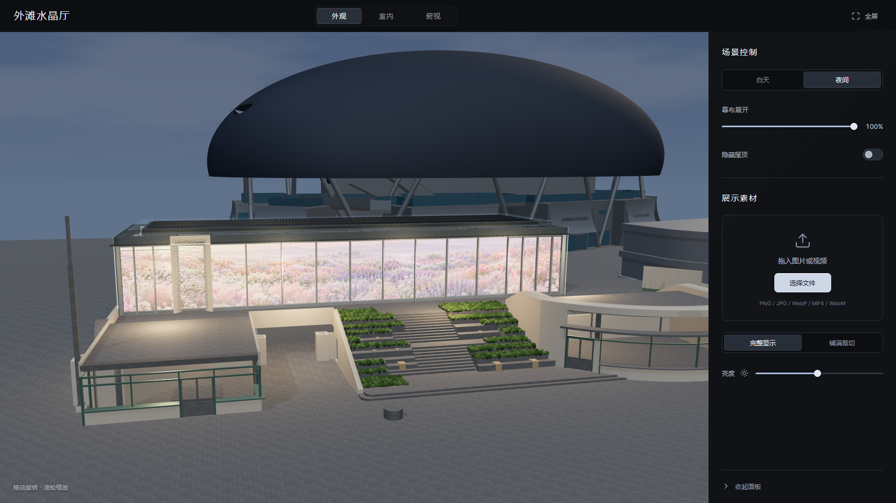

# 外滩水晶厅 · 数字花海

基于真实 Rhino 建筑几何制作的 Three.js 背投展示场景。精细呈现水晶厅、玻璃幕墙、台阶与平台，支持将本地图片或视频放入整幅数字幕面，直接预览室外观看效果。

**[在线预览 →](https://pyw110001.github.io/thebund-interactive-projection/)** · [部署状态](https://github.com/pyw110001/thebund-interactive-projection/actions/workflows/pages.yml)



## 功能

- **建筑三维预览**：自由旋转、缩放和平移，外观／室内／俯视三种预设相机。
- **自定义素材**：选择或拖入 PNG、JPEG、WebP、MP4、WebM；完整显示或铺满裁切，保持素材比例。
- **视频播放**：播放／暂停、进度拖动、循环和静音控制。
- **背投演示**：白天收幕、夜间展幕，也可手动调整幕布展开比例和显示亮度。
- **暗黑美学**：近黑与石墨灰界面、低饱和选中态、浅银色按钮，可收起控制面板。
- **平滑过渡**：面板滑动淡出、屋顶渐隐渐现、日夜光线混合和素材控件展开；支持中途反向切换。
- **移动端适配**：底部控制面板与自适应取景，支持系统“减少动态效果”偏好。

选择的图片和视频通过浏览器 File / Blob API 在本机处理，不会上传到 GitHub 或其他服务器。刷新后恢复内置花海。视频格式需由当前浏览器支持，推荐 H.264 MP4 或 VP8／VP9 WebM。

## 本地运行

需要 **Node.js 24**（已在24.11.1验证）和 npm。

```bash
git clone https://github.com/pyw110001/thebund-interactive-projection.git
cd thebund-interactive-projection
npm ci
npm run dev
```

打开 [本地开发预览](http://127.0.0.1:4185/)。

```bash
npm run build
npm run preview
```

打开 [本地构建预览](http://127.0.0.1:4186/)。生产文件位于 `dist/`，可部署到普通静态站点；不能直接双击 HTML 文件运行。

## GitHub Pages

推送到 `main` 会触发 `.github/workflows/pages.yml`：

1. 使用 Node.js 24 安装锁定依赖。
2. 验证素材适配、幕面UV和GLB格式。
3. 按仓库子路径构建 Vite 项目。
4. 将 `dist/` 部署到 GitHub Pages。

也可以在 **Actions → Deploy GitHub Pages → Run workflow** 手动重新部署。发布源为 **GitHub Actions**。本地构建默认使用相对路径，Pages 构建通过 `PAGES_BASE_PATH` 设置仓库路径，二者互不影响。

## 项目结构

| 路径 | 内容 |
| --- | --- |
| `src/scene.ts` | Three.js 场景、相机、卷幕与屋顶／光线过渡 |
| `src/App.tsx`、`src/Reveal.tsx` | 控制界面、素材状态与显隐动画 |
| `src/media.ts` | 图片／视频解码及资源释放 |
| `src/dark-theme.css` | 暗黑主题与响应式过渡 |
| `public/assets/crystal-hall.glb` | 独立GLB，内嵌贴图与收幕形变 |
| `public/assets/scene-config.json` | 建筑尺寸、幕面参数及相机预设 |
| `scripts/` | Rhino转换、Blender构建、本地服务与验收工具 |
| `tests/` | 素材比例、卷幕UV、模型结构和glTF规范验证 |
| `docs/LOCAL_GUIDE.md` | 完整本地工程与模型重建说明 |

## 模型与幕面

- 建筑基准约 **40m × 12m × 5.8m**；主体几何按原始 Rhino 模型转换，周边简化。
- 演示幕面 **39.6m × 5.4m**，距常规玻璃内表面约 **0.4m**。
- 场景以米为单位，GLB为Y轴向上，主要观看立面朝+Z。
- `ProjectionScreen` 的 `Retracted` 形变：0为展开，1为收起。网页通过统一UV保持收幕过程中图像的位置与比例。

整幅连续卷幕用于空间和画面效果演示；真实机械、门洞、投影机数量、亮度及工程预算需另行深化。

## 验证与模型重建

```bash
npm test
```

公开仓库包含网页运行所需GLB和图片，不包含原始 `.3dm`、`.blend`、本地测试素材、缓存或渲染视频。源文件哈希测试仅在本地存在原始Rhino文件时执行；公开CI检查其余测试及GLB规范。

网页源码克隆后即可直接运行，无需安装 Rhino 或 Blender。若要重新生成模型，请自行将有权使用的 `Crytral Hall.3dm` 放到项目根目录，参照[本地工程说明](docs/LOCAL_GUIDE.md)运行转换脚本。完整源建模文件仍保留在原本地工作目录中。

## 技术与素材

React 19 · TypeScript · Vite · Three.js · Blender 5.1 · rhino3dm。

花海示例为独立生成的静态画作，用户素材可随时替换；铺地和既有种植区细节为确定性程序生成。说明见[素材记录](design/assets.md)，运行依赖的许可证见[第三方声明](public/THIRD_PARTY_NOTICES.txt)。
